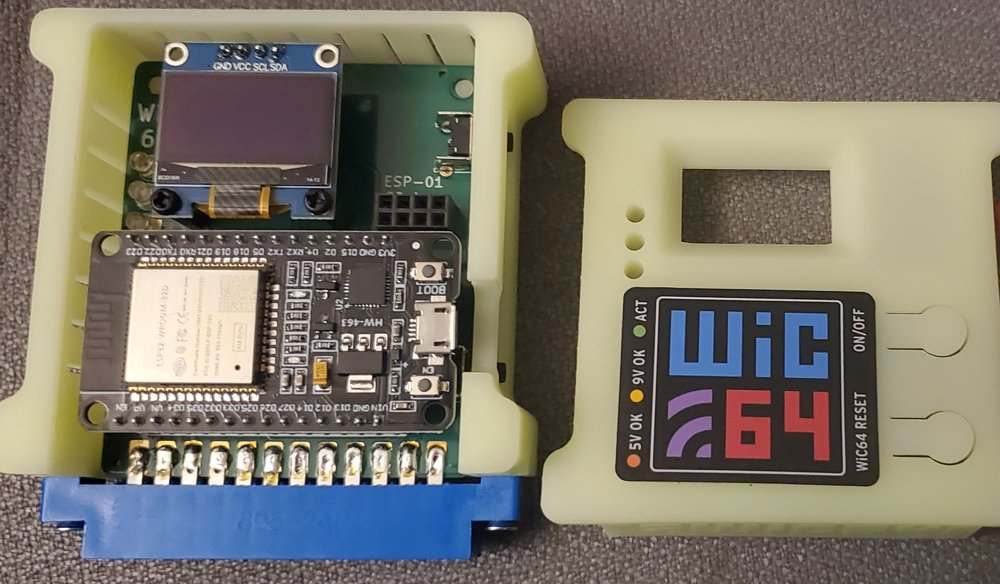

<p align="center">
  
</p>

<h1 align="center">VDRIVE</h1>

<p align="center">
  <b>Wirelessly SEARCH/MOUNT disk images and LOAD/SAVE data to/from your Commodore 64.</b><br/>
  A C64 client over the <a href="https://wic64.net/web/">WiC64</a> and a C# .NET server.
</p>

<p align="center">
  <a href="#try-it-live">Try it live</a> ·
  <a href="#quickstart">Quickstart</a> ·
  <a href="#using-vdrive">Using VDRIVE</a> ·
  <a href="#programs-that-fill-all-of-memory-p">Full-memory loads</a> ·
  <a href="#writing-disks-to-a-real-drive-w">Disk writer</a> ·
  <a href="#videos">Videos</a> ·
  <a href="#install-steps-wic64">Install</a> ·
  <a href="#server-configuration-reference">Configuration</a> ·
  <a href="Examples">Examples &amp; API</a>
</p>

---

## Highlights

- **Remote disk access from the C64.** Search, mount, LOAD and SAVE over HTTP, directly from the C64.
- **Built for sharing work.** Programmers, artists and musicians can share disk images in real time: save on the C64, inspect or change the file with modern tools, then load it back. No SD card swaps or manual copying.
- **Safe concurrency.** Several C64s can LOAD and SAVE to the same disk image without corruption. File access uses read/write locks with a Last‑Write‑Wins model.
- **Programs that fill all of memory load too,** including over VDRIVE itself at `$C000`: the server sends a small patch stub that takes the program and runs it. See [`,P`](#programs-that-fill-all-of-memory-p).
- **Disks to a real drive.** `,W` writes a disk image, or a whole multi-disk set, from VDRIVE to an SD2IEC, mounts it and starts the game, with the game's own loaders and disk swaps. See [`,W`](#writing-disks-to-a-real-drive-w).
- **Local and remote collections.** Local folders, [Commodore.Software](https://commodore.software/), and the [High Voltage SID Collection](https://www.hvsc.c64.org/) as a SID jukebox.

---

## Try It Live

<p align="center">
  <a href="https://8bitflynn.io/Projects#vdrive-c64"><b>▶ Try VDRIVE in your browser</b></a>
  &nbsp;&nbsp;·&nbsp;&nbsp;
  <a href="https://8bitflynn.io/Resources/vdrivewic64.prg"><b>⬇ Download vdrivewic64.prg</b></a>
</p>

In the browser, a C64 with an emulated WiC64 runs the real `vdrivewic64.prg`. On a real C64 with a WiC64, load the same file: it points at the public VDRIVE server.

---

## Quickstart

Ready‑to‑run binaries are in the [v1.0.0‑beta release](https://github.com/8bitflynn/VDRIVE/releases/tag/v1.0.0-beta).

> [!TIP]
> No real Commodore 64 or WiC64? Use [VICE 3.10](https://vice-emu.sourceforge.io/index.html#download) with WiC64 emulation turned on, under **Settings → Userport devices**.


No other settings need to be changed: `vdrivewic64.prg` has the server URL inside it. Open it in a [HEX editor](https://mh-nexus.de/en/hxd/) and point the URL to your VDRIVE server, for example `http://192.168.1.222/` (80 characters max). An optional token (7 characters max) follows the URL; see `AllowedAuthTokens` below.

> [!NOTE]
> The trailing slash is needed, or the request URLs will not be formed correctly.


The URL and the token move when the client changes size, but two pointers near the start of the client always say where they are (low byte first):

| Address | File offset | Points to |
|---|---|---|
| `$C028`/`$C029` | `$2A`/`$2B` | The server URL (80 bytes, zero terminated) |
| `$C032`/`$C033` | `$34`/`$35` | The token (8 bytes, zero terminated) |

The file offset is the address minus `$C000`, plus 2 for the PRG's load address. A patcher can follow these pointers instead of searching for the text.

---

## Using VDRIVE

From your Commodore 64 (real hardware or VICE with WiC64 emulation):

```text
LOAD "vdrive_wic64.prg",8,1
```

| Command | Does |
|---|---|
| `SYS 49152` | Enable VDRIVE |
| `SYS 49155` | Disable VDRIVE |
| `SYS 49158` | Search for disk images |
| `SYS 49161` | Mount a different floppy from the previous search |

- Search results show sequence numbers and filenames/descriptions.
- Enter a number to mount a disk from the results; `+` / `-` page through them.
- At the search prompt, `@` picks where to search. The choice stays with your session for the following searches:

| At the search prompt | Does |
|---|---|
| `@LOCAL` | Search this server's own folders (the default) |
| `@CS` | Search [Commodore.Software](https://commodore.software/) |
| `@HVSC` | Search the HVSC SID music collection (each tune comes as a program that plays it) |
| `@NEW NAME` | Make an empty disk to save to |
| `@?` or `@HELP` | List these commands |

- Previously found floppies can be mounted again by their sequence number.
- `LOAD` and `SAVE` work as usual and are routed through VDRIVE.

### Programs That Fill All of Memory: `,P`

VDRIVE runs at `$C000`. A program that loads over it is sent through a patch stub instead:

```text
LOAD "NAME,P",8
```

1. The server answers with a small stub (load status `$FE`: run after load). VDRIVE loads it to `$0100` and runs it.
2. The stub asks for the program and receives it itself, so it can write anywhere from `$0200` to `$FFFF`: over VDRIVE, and into the RAM under BASIC, the KERNAL and I/O.
3. Then it RUNs a program that loads at `$0801`, or goes to `READY.` for anything else.

A plain `LOAD` of a program that would land on `$C000-$CFFF` uses the stub automatically, so `LOAD "NAME",8` just works. Everything else is an ordinary load. The stub source is [`stubs/patch_run.asm`](stubs/patch_run.asm).

### Writing Disks to a Real Drive: `,W`

Mount a D64 (or a single program) from a search, then:

| Command | Does |
|---|---|
| `LOAD "*,W",8` | Write the mounted disk to drive 8, mount it there and start the game |
| `LOAD "*,W9",8` | The same on drive 9 (any drive from 8 to 30) |
| `LOAD "*,W@",8` | Write it again even if it is already on the drive (`@` like `SAVE"@:..."`) |

What happens, all from one stub the server sends:

1. The disk goes into a `VDRIVE` folder on the card, with a short unique name (`THRUST-F531.D64`). The stub pulls it from VDRIVE in 32K slices and writes it slice by slice; it gets its real name only when complete.
2. A disk that is already there is not written again: the first time takes about a minute per disk on an SD2IEC (see JiffyDOS below), every time after that a few seconds.
3. **Multi-disk games:** every disk of the set is written (`MYGAME1-8920.D64`, `MYGAME2-9F83.D64`...) plus a swap list. The SD2IEC mounts disk 1, and its **NEXT** button changes disks when the game asks.
4. The drive mounts the disk and the game is loaded from it and started the way BASIC's own `LOAD` ends (`READY.`, then BASIC's main loop through `$0302`), so autostart loaders take over just as they do from a real drive. If the drive is on VDRIVE's own number, VDRIVE switches itself off, so the game's later loads go to the drive.
5. **A single program** (a `.PRG` mounted instead of a D64) is written as `NAME.PRG` (up to 12 characters of its name, so the whole name fits in 16) and nothing is mounted or started: `VDRIVE: SAVED ON #8`, then `READY.` The stub that did the writing is still at `$0801`, so `LIST` shows nonsense there; the program itself is on the drive. VDRIVE stays on, and it answers every `LOAD` on device 8 while it's on, so to load the program back from drive 8, switch VDRIVE off first (`SYS 49155`). On any other device number (an IDE64 on 12) just load it.

**IDE64.** Put its device number after the `W` (`LOAD "*,W12",8`). Disks and programs are written the same way, through the KERNAL (IDEDOS takes the bytes straight to its card, so a whole disk takes about 45 seconds, nearly all of it the download). The IDE64 can't mount disk images, so a disk ends with `SAVED ON #12, NOT MOUNTED`.

**JiffyDOS.** A drive that answers JiffyDOS (the SD2IEC does) gets each slice with the JiffyDOS protocol: two bits at a time on the serial bus' clock and data lines, at fixed moments 10, 23, 34 and 47 µs apart, with no handshake per bit. The stub drives the bus itself, cycle exact, and starts each byte only where no bad line (the VIC-II's stolen cycles) can hit it, so the screen stays on. A whole D64 takes about 70 seconds instead of about 3 minutes 40 with the KERNAL, download from VDRIVE included. Any other drive (a 1541 without JiffyDOS, the IDE64's own drive number) gets the KERNAL's normal serial routines, automatically.

Tested on a real SD2IEC. The SD2IEC runs the fast loaders it knows (JiffyDOS, Final Cartridge 3, DreamLoad and others); a game with a loader it doesn't know fails on the SD2IEC with or without VDRIVE. The stub source is [`stubs/patch_write.asm`](stubs/patch_write.asm).

After changing a stub (`patch_write.asm` or `patch_run.asm`), run `powershell -ExecutionPolicy Bypass -File stubs\build_stubs.ps1` from the solution folder: it assembles both with ACME and updates their bytes in `PatchStubs.cs` (`-Check` only compares).

### Known Limitations

- After a program has loaded over `$C000` (with `,P` or automatically), VDRIVE is gone until it is loaded again, so a game that loads more files later can't get them that way: use `,W` to put the disk on a real drive.
- With `,P`, bytes for `$DD00-$DDFF` (CIA 2, which talks to the WiC64) go into the RAM under I/O instead of the chip. The rest of `$D000-$DFFF` (VIC-II, SID, color RAM, CIA 1) is written like a real drive's LOAD.
- `,W` writes D64 images (up to 9 disks per set) and single programs, and is tested with SD2IEC and IDE64; writing to a real 1541 floppy is not supported yet.

### Building On VDRIVE

VDRIVE has a jump table and API pointers at `$C000` for BASIC and machine language programs to search, mount, load and save directly. The [Examples](Examples) directory has sample programs and the full API reference.

---

## Videos

| Video | Shows |
|---|---|
| [PRG LOAD](https://8bitflynn.io/Resources/Videos/VDRIVE_COMMANDO.m4v) | Loading the Commando PRG from search results. |
| [Paging](https://8bitflynn.io/Resources/Videos/VDRIVE_PAGING.m4v) | Search supports up to 65,535 results. |
| [Remote](https://8bitflynn.io/Resources/Videos/VDRIVE_WIC64_Test.m4v) | Searching [Commodore.Software](https://commodore.software/) from the internet and mounting disks. |
| [BASIC ILOAD](https://8bitflynn.io/Resources/Videos/VDRIVE_BASIC_ILOAD.m4v) | C64 BASIC searching, mounting and loading through the API. |
| [Jukebox](https://8bitflynn.io/Resources/Videos/VDRIVE_HVSCPSID.m4v) | The HvscPsid floppy resolver searching the [High Voltage SID Collection](https://www.hvsc.c64.org/); [PSID64](https://psid64.sourceforge.io/) converts the SID files to PRG so the C64 plays them instantly. |

---

## Install Steps (WiC64)

**1. Use a WiC64.** Connect a real [WiC64](https://wic64.net/web/), or enable WiC64 emulation in **VICE 3.9+**.

**2. Build the C64 client.** Assemble [`vdrive_wic64.asm`](vdrive_wic64.asm) with the [ACME cross assembler](https://github.com/meonwax/acme):

```text
acme -f cbm -o vdrive_wic64.prg vdrive_wic64.asm
```

It needs `wic64.h`, `wic64.asm` and `examples/macros.asm` from the [WiC64 library](https://github.com/WiC64-Team/wic64-library) next to it. The client talks to the server over HTTP through the WiC64.

**3. Configure the server.** Edit `appsettings.json` to set the search paths VDRIVE should scan. To keep your own folders and tokens off GitHub, put them in `appsettings.private.json` next to it instead (same layout, only the settings you change; it is in `.gitignore`). Values and lists in it replace the ones in `appsettings.json`. A remote `IFloppyResolver` can be configured for distributed setups. See the [configuration reference](#server-configuration-reference) below and the [configuration docs](docs/README.md).

**4. Run the server.** Launch the C# .NET server. VDRIVE runs on [any OS with the .NET runtime](https://github.com/dotnet/core/blob/main/release-notes/8.0/supported-os.md).

---

## Server Configuration Reference

<details open>
<summary><b>Every field in <code>appsettings.json</code></b> (click to fold)</summary>

#### Authentication

| Setting | Meaning |
|---|---|
| `AllowedAuthTokens` | Optional list of tokens allowed to use the server. Empty = all clients. The token is embedded in the C64 client after the URL and sent with every request. |

#### Storage

| Setting | Meaning |
|---|---|
| `StorageAdapter` | Backend for disk image operations: `DirMaster` or `Vice`. Default: `Vice`. |
| `StorageAdapterSettings.ReadOnly` | No changes to disk images when true (SAVE answers `WRITE PROTECT ON`). |
| `StorageAdapterSettings.NewFloppyPath` | Folder for new floppy images. |
| `StorageAdapterSettings.DirMaster` | Python + CBMdisk integration. |
| `StorageAdapterSettings.Vice` | Uses `c1541.exe`, tested with version 2.4. |
| `WriteFolder` | The folder on the C64's drive (SD2IEC, IDE64) that `,W` writes disks and programs into. Default: `VDRIVE`. |

#### Floppy Resolver

| Setting | Meaning |
|---|---|
| `FloppyResolver` | How disk images are found: `Local`, `CommodoreSoftware` or `HvscPsid`. |
| `Local` | Scans folders (recursive if enabled) for `.d64`, `.prg` and more. `GroupMultiDiskImages` groups the disks of a multi-disk set. |
| `CommodoreSoftware` | Remote search on [Commodore.Software](https://commodore.software/). |
| `HvscPsid` | SID music resolver using `psid64.exe`. |

#### Logging

| Setting | Meaning |
|---|---|
| `LoggingLevel` | `Verbose`, `Info`, `Warning`, `Error` or `Critical`. Default: `Verbose`. |
| `LogPath` | Folder for the daily log file `vdrive-yyyyMMdd.log` (the same lines as the console). Empty = a `logs` folder next to the executable. |

#### Session & Search

| Setting | Meaning |
|---|---|
| `SessionTimeoutMinutes` | Default: 90. |
| `MaxSearchResults` | Default: 65535. |
| `SearchPageSize` | Results per page on the C64 (fewer when long names would overflow its buffer). Default: 15. |
| `WebSearchPageSize` | Results per page for web clients. Default: 20. |
| `SearchIntroMessage` | Optional banner text. |

#### Temporary Storage

| Setting | Meaning |
|---|---|
| `TempPath` | Custom temp folder (empty = system default). |
| `TempFolder` | Scratch folder name. Default: `VDRIVE_Scratch`. |

#### Networking (WiC64)

| Setting | Meaning |
|---|---|
| `ServerOrClientMode` | Always `Server` with the WiC64. |
| `ServerType` | Always `Http`. |
| `ServerListenAddress` | Bind address. Default: `http://*:` |
| `ServerPort` | Default: `80`. |
| `SendTimeoutSeconds` / `ReceiveTimeoutSeconds` | Default: 15 each. |

</details>

---

## How It Works



**WiC64 (ESP32‑based, memory‑mapped).** VDRIVE runs on the [WiC64](https://wic64.net/web/). The WiC64 is memory‑mapped directly to the C64 through the user port, bypassing the limits of serial (IEC) communication and loading large binaries in seconds.

**StorageAdapters.** Modular `StorageAdapters` handle every `LOAD`, `SAVE` and directory operation. They use:

- [`c1541.exe`](https://vice-emu.sourceforge.io/) from **VICE**, the command‑line tool for Commodore disk images.
- [`cbmdisk.pyd`](https://style64.org/cbmdisk) from **[DirMaster](https://style64.org/dirmaster)**, a Python wrapper for disk image access.

**FloppyResolvers.** The `FloppyResolver` system finds disk images in **local folders** (`.D64`, `.PRG` and other CBM files) and **remote archives** such as [Commodore.Software](https://commodore.software/). The [HvscPsidFloppyResolver](VDRIVE/Floppy/Impl/HvscPsidFloppyResolver.cs) searches the [High Voltage SID Collection](https://www.hvsc.c64.org/) and converts SID files to PRG with [PSID64](https://psid64.sourceforge.io/), turning the C64 into a SID jukebox.
